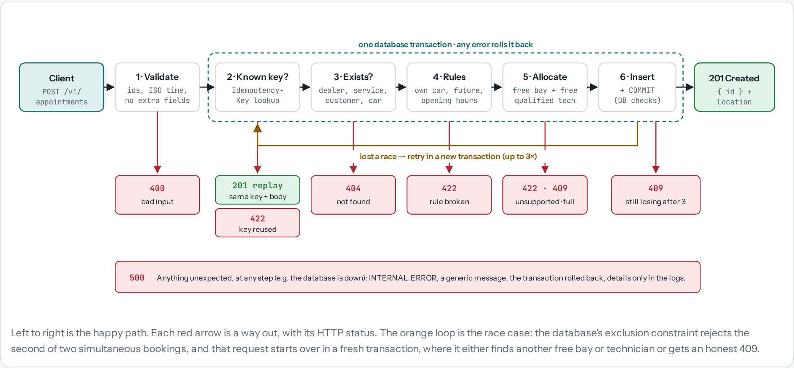
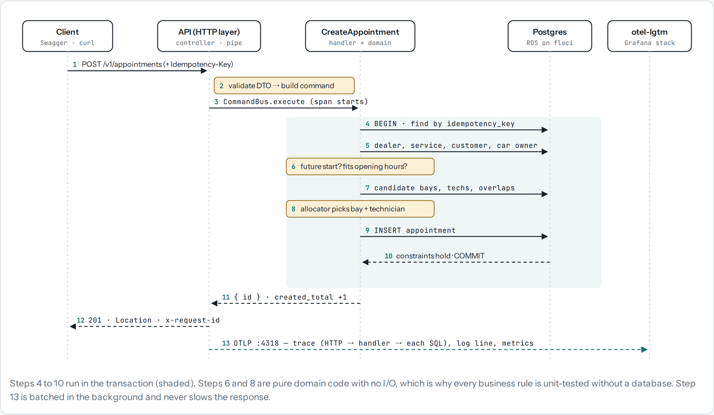
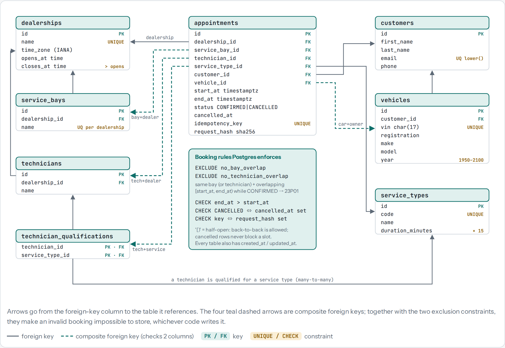
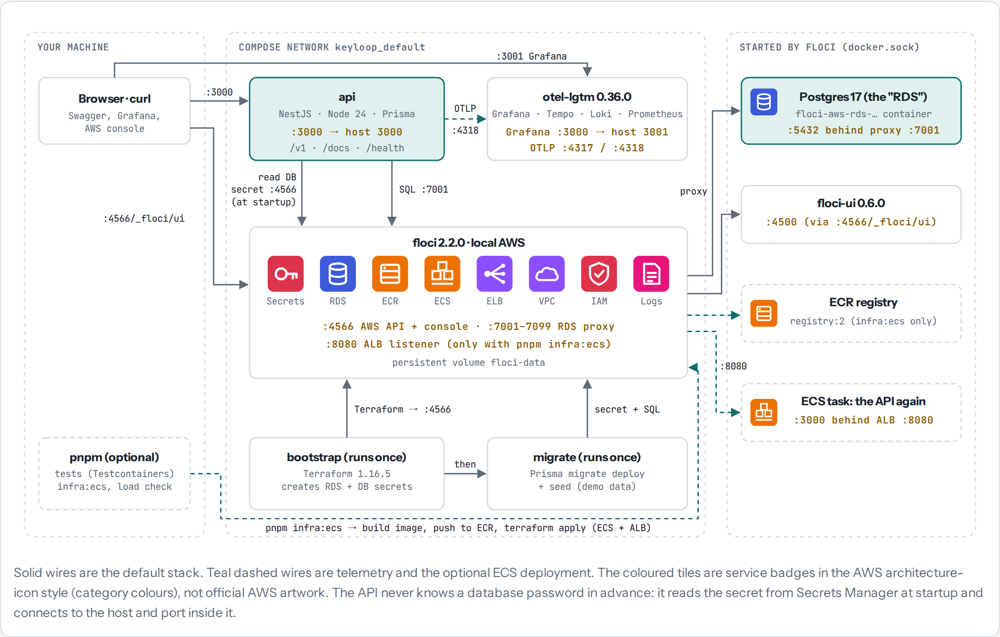

# Keyloop Service Scheduler

A backend API for **Scenario A: The Unified Service Scheduler**.

A customer asks for a service appointment: *this vehicle, this service, at this dealership, at this time*.
Before confirming, the API checks that a **service bay** and a **technician qualified for that service** are both
free for the **whole** duration. It then picks them and saves a confirmed appointment that links the customer,
vehicle, technician and bay.

**In 30 seconds:**
- **It never double-books.** Two requests at the same moment can't get the same bay or technician. The database
  itself enforces this, and a request that loses the race retries automatically.
- **It says why.** A rejected booking gets a specific code, such as `NO_SERVICE_BAY_AVAILABLE`,
  `NO_TECHNICIAN_AVAILABLE` or `OUTSIDE_OPENING_HOURS`.
- **It's small extras, done properly:** an availability query, cancellation, listing with pagination, and safe
  retries with an `Idempotency-Key`.
- **It runs like it would on AWS, on your laptop:** Postgres on RDS, credentials in Secrets Manager (emulated by
  [floci](https://floci.io), created with Terraform), and traces, logs and metrics in Grafana.

**Contents:** [What you need](#what-you-need) · [Start it](#1-start-it) · [Try it](#2-try-it) ·
[See it in Grafana](#3-see-what-happened-in-grafana) · [15-minute tour](#a-15-minute-tour-for-reviewers) ·
[How it works](#how-it-works) · [Diagrams](#diagrams) · [Where the code is](#where-the-code-is) · [Run the tests](#run-the-tests) ·
[Extras](#extras) · [All docs](#all-docs)

## What you need
Only **Docker**. You don't need Node, AWS, or anything else installed to run it.

| | Requirement |
|---|---|
| **Docker** | Docker Desktop (Windows, macOS) or Docker Engine (Linux) with **Compose v2**, i.e. the `docker compose` command, not the old `docker-compose`. Podman works too (see [If something goes wrong](#if-something-goes-wrong)) |
| **Memory** | Give Docker at least **4 GB**. The running stack uses about 1 GB; building the images needs more |
| **Disk** | About **6 GB** free for images (Grafana's all-in-one image alone is 2.7 GB) |
| **Network** | Internet for the first run: about **3.5 GB** of images to download |
| **Free ports** | 3000 (API), 3001 (Grafana), 4317–4318 (telemetry), 4566 (AWS emulation), 7001 (Postgres) |
| **Docker socket** | Must be available to containers: floci starts the Postgres container through it. This is the default in Docker Desktop |
| **Optional** | Node 24 and pnpm, only to run the tests or work on the code ([Run the tests](#run-the-tests)) |

Tested on Windows 11 (Podman) and Ubuntu (CI, on every pull request). macOS and Apple Silicon have not been tested.

## 1. Start it
```bash
git clone https://github.com/rogeryudya/keyloop-scenario-a.git
cd keyloop-scenario-a
docker compose --profile app up --build -d --wait
```

**The first run takes about 5 minutes:** downloading images, building the API, then about 1.5 minutes to create
the database. Later runs take seconds.

What happens, in order:
1. **floci** starts: the local AWS (RDS + Secrets Manager).
2. **bootstrap** runs Terraform: it creates the Postgres database and puts its password in Secrets Manager.
3. **migrate** creates the tables and loads the demo data.
4. **api** starts, reads its database password from Secrets Manager, and passes its health check.

**It's ready when** the command returns with every container `Healthy` or `Exited` (the two one-off setup jobs),
and this answers:

```bash
curl http://localhost:3000/health
# {"status":"ok","db":"up"}
```

| Open | Address |
|---|---|
| API docs, try requests here (Swagger) | http://localhost:3000/docs |
| Grafana: traces, logs, metrics | http://localhost:3001 |
| AWS console (floci): the database and its secrets | http://localhost:4566/_floci/ui |

**Stop it:** `docker compose --profile app down`, which keeps the data.
**Start completely fresh:** `docker compose --profile app down -v`, then the start command again.
**Watch the API's logs:** `docker compose logs -f api`.

### If something goes wrong
- **Podman:** prefix the command: `DOCKER_BUILDKIT=0 docker compose --profile app up --build -d --wait`.
- **"Port is already allocated":** something else uses one of the ports above. Stop it, or free the port.
- **It hangs at `bootstrap`, or the database never comes up:** the Docker socket isn't available to containers.
  Check your Docker settings.
- **Something else:** `docker compose --profile app ps` shows which step failed, and
  `docker compose --profile app logs <service>` shows why. More in [docs/local-dev/](docs/local-dev/README.md).

## 2. Try it
The demo data has 6 dealerships in Thailand and Vietnam, with their bays and technicians, 10 service types,
16 customers and 22 vehicles. Demo bookings are always placed **tomorrow** (and the following days), so the
examples below keep working. All times are local to the dealership, which is UTC+7.
Details: [prisma/seed/README.md](prisma/seed/README.md).

**The quickest way: Swagger.** Open http://localhost:3000/docs, choose `POST /v1/appointments`, click *Try it out*,
and send the example as it is (an oil change at Bangkok on 2030-01-15, 10:00). You get a `201` with the new
appointment's id. Send it again: another `201`. Send it a third time: `409 NO_TECHNICIAN_AVAILABLE`. Bangkok has
three bays but only two technicians who do oil changes, and both are now booked at 10:00.

**The guided way: the demo request files.** [test/http/](test/http/) has ready-made requests. Open them in VS Code
with the [REST Client](https://marketplace.visualstudio.com/items?itemName=humao.rest-client) extension (VS Code
suggests it when you open the repo) and click *Send Request* above each one. They fill in tomorrow's date for you.

| File | What it shows |
|---|---|
| [booking-scenarios.http](test/http/booking-scenarios.http) | One request per business rule, each with its expected result (the table below) |
| [appointment-lifecycle.http](test/http/appointment-lifecycle.http) | Book, retry safely, read, list, cancel, then book the freed slot again |
| [reference-data.http](test/http/reference-data.http) | Dealerships, service types, and free time slots |
| [parallel-booking.sh](test/http/parallel-booking.sh) | 10 identical bookings at the same moment for a slot with only one bay |

What the booking scenarios show:

| # | Request (tomorrow) | Result | Why |
|---|---|---|---|
| 1 | Somsak books an oil change at Bangkok, 11:00 | `201`: a bay and a qualified technician are assigned | The happy path |
| 2 | Tuan books an oil change at Hanoi, 10:00 | `409 NO_SERVICE_BAY_AVAILABLE` | Hanoi's only bay is taken |
| 3 | The same at 10:30 | `201` | Back-to-back bookings are fine |
| 4 | Prasit books a transmission repair at Bangkok, 09:30 | `409 NO_TECHNICIAN_AVAILABLE` | Bays are free, but the only qualified technician is busy |
| 5 | The same at 10:30 | `201`, with that technician | The technician is free from 10:30 |
| 6 | An EV battery check at Hanoi | `422 SERVICE_TYPE_NOT_SUPPORTED` | Nobody there is qualified |
| 7 | Malee books with Somsak's car | `422 VEHICLE_NOT_OWNED_BY_CUSTOMER` | You can only book your own vehicle |
| 8 | A 2-hour service at 15:30, closing at 17:00 | `422 OUTSIDE_OPENING_HOURS` | It would end after closing |
| 9 | Hanoi at 14:00, where a *cancelled* booking sits | `201` | Cancelled bookings free their slot |
| 10 | 10 requests at once for one Hanoi slot (`bash test/http/parallel-booking.sh`) | One `201`, nine `409` | No double-booking under load |
| 11 | A start time in the past | `422 APPOINTMENT_IN_PAST` | |

Running the scenarios file twice is safe: successful bookings carry an `Idempotency-Key`, so they are replayed,
not booked again. If you keep the stack running past midnight in Bangkok, move the demo bookings to the new
"tomorrow" with `docker compose --profile app run --rm migrate`.

## 3. See what happened in Grafana
Open http://localhost:3001 and go to **Explore**. Every API response has an `x-request-id` header you can search for.

| Data source | Try | You see |
|---|---|---|
| **Tempo** (traces) | `{span.outcome="conflict"}` | Each rejected booking: the request, the use case with its reason, and every SQL query, with timings |
| **Loki** (logs) | `{service_name="keyloop-api"} \| request_id="<the id>"` | That request's log line, with a `trace_id` that leads to its trace |
| **Prometheus** (metrics) | `appointment_rejections_total` | Rejections counted by reason; also `appointments_created_total` and request latency |

More queries: [docs/local-dev/observability.md](docs/local-dev/observability.md).

## A 15-minute tour for reviewers
1. **Start it** ([step 1](#1-start-it)) and open Swagger. *2 min, plus the first-run wait.*
2. **Book scenario 1, then scenario 2** from [booking-scenarios.http](test/http/booking-scenarios.http) (or in
   Swagger). Note the `201`, then the `409 NO_SERVICE_BAY_AVAILABLE`. *2 min*
3. **Run `bash test/http/parallel-booking.sh`.** Ten requests race for one slot: one wins, nine get `409`. *1 min*
4. **Open the rejected booking's trace** in Grafana (Tempo, `{span.outcome="conflict"}`). You can see the check,
   the reason, and the SQL. *2 min*
5. **Read [How it works](#how-it-works)** below, then the three files that matter most: the booking handler, the
   allocator and the database constraint ([Where the code is](#where-the-code-is)). *5 min*
6. **Skim [docs/design-notes.md](docs/design-notes.md)** for the trade-offs, assumptions and what I'd do next. *3 min*

## How it works
```
POST /v1/appointments
  │  1. Validate the request (shape, ids, ISO time with offset)            → 400 if malformed
  ▼
CreateAppointment handler, in ONE database transaction:
  │  2. Known Idempotency-Key? → return the original booking
  │  3. Dealership, service, customer and vehicle exist?                   → 404
  │  4. Vehicle belongs to the customer? Start in the future?
  │     Fits opening hours?                                                → 422
  │  5. Allocator: nobody here does this service?                          → 422
  │     Pick a free bay and a free qualified technician                    → 409 if none
  │  6. INSERT the appointment
  ▼
Postgres exclusion constraint: no two confirmed bookings may overlap on the same bay or technician.
  If a parallel request got there first, the insert fails → retry from step 2 (up to 3 times).
```

- **Why the database has the final say:** checking in code alone has a race. Two requests can both see "bay 1 is
  free" and both book it. The exclusion constraint makes the second insert fail, whatever code path wrote it.
- **How resources are picked:** the lowest-id free bay, and the free qualified technician with the fewest bookings
  that day. Same input, same result, so it's easy to test and explain.
- **Availability** (`GET /v1/dealerships/:id/availability`) runs the same allocator for every 15-minute slot of a
  day, so a slot it lists can really be booked.

The full story, with trade-offs: [docs/design-notes.md](docs/design-notes.md).

## Diagrams
The same system in four pictures. They follow your GitHub light or dark theme.
**[Open the interactive version](https://rogeryudya.github.io/keyloop-scenario-a/diagrams/blueprints.html)**, with
tabs, copyable text and the detail tables, or open [docs/diagrams/blueprints.html](docs/diagrams/blueprints.html) from
your clone in a browser.

**What happens to a booking request:** six checkpoints, each with its own way out, and the retry when two requests race.

<picture>
  <source media="(prefers-color-scheme: dark)" srcset="docs/diagrams/request-pipeline-dark.png">
  
</picture>

**The happy path, call by call:** the shaded steps run in one database transaction.

<picture>
  <source media="(prefers-color-scheme: dark)" srcset="docs/diagrams/happy-path-sequence-dark.png">
  
</picture>

**The data model:** all 8 tables. The dashed arrows are composite foreign keys; with the two exclusion constraints,
the database itself refuses an invalid booking.

<picture>
  <source media="(prefers-color-scheme: dark)" srcset="docs/diagrams/data-model-dark.png">
  
</picture>

**What runs where, and on which port:** the API, Grafana and floci (the local AWS) on one Docker network.

<picture>
  <source media="(prefers-color-scheme: dark)" srcset="docs/diagrams/tech-stack-dark.png">
  
</picture>

To redraw them after changing `docs/diagrams/blueprints.html`: `pnpm docs:diagrams`, which renders the PNGs in Docker.

## Where the code is
Each feature module has the same four layers: `domain` (business rules, plain TypeScript), `application` (use
cases), `infrastructure` (database) and `presentation` (HTTP). Dependencies only point inward, towards `domain`,
and a lint rule fails the build if they don't.

| What | File |
|---|---|
| The booking use case: checks, allocation, insert, retry | [create-appointment.handler.ts](src/modules/appointments/application/commands/create-appointment/create-appointment.handler.ts) |
| Picking a bay and a technician | [resource-allocator.ts](src/modules/appointments/domain/resource-allocator.ts) |
| Free time slots for a day | [availability.ts](src/modules/appointments/domain/availability.ts) |
| The appointment and its rules (future start, opening hours, cancel) | [appointment.entity.ts](src/modules/appointments/domain/appointment.entity.ts) |
| Time intervals and opening hours in the dealership's time zone | [time-slot.ts](src/shared/domain/time-slot.ts), [opening-hours.ts](src/shared/domain/opening-hours.ts) |
| The no-double-booking constraint in the database | [m1_constraints/migration.sql](prisma/migrations/20261012041657_m1_constraints/migration.sql) |
| Turning a lost race into a retry | [prisma-appointment.repository.ts](src/modules/appointments/infrastructure/prisma-appointment.repository.ts) |
| The HTTP endpoints | [appointment.controller.ts](src/modules/appointments/presentation/appointment.controller.ts) |
| Errors → one consistent JSON format | [global-exception.filter.ts](src/shared/presentation/filters/global-exception.filter.ts) |
| Proof that parallel bookings never collide (real Postgres) | [create-appointment.int-spec.ts](test/concurrency/create-appointment.int-spec.ts) |

How a request travels through the layers: [docs/architecture/request-flow.md](docs/architecture/request-flow.md).
Where every kind of file goes: [docs/architecture/folder-structure.md](docs/architecture/folder-structure.md).

## Run the tests
Needs **Node 24** and **pnpm** (`corepack enable` installs pnpm). The integration and end-to-end tests start their
own Postgres with Testcontainers, so Docker must be running. They don't need the stack from step 1.

```bash
pnpm install
pnpm test          # unit tests: business rules and use cases (no Docker, ~30 s)
pnpm test:int      # integration: real Postgres, including parallel booking races
pnpm test:e2e      # end to end: the HTTP API against the real app
pnpm test:all      # all of the above, plus lint and type checks
```

GitHub runs all of these on every pull request, plus a test that starts the full Docker stack from scratch
([docs/ci.md](docs/ci.md)). Business rules and use cases must keep at least 90% test coverage.

## Extras
**A load check.** With the stack running, `pnpm load:booking` sends 200 bookings at once and checks that nothing is
double-booked. Results and analysis: [docs/design-notes.md › Load check](docs/design-notes.md#load-check-m5).

**Run it the AWS way, on ECS.** `pnpm infra:ecs` builds the image, pushes it to a local ECR, and runs it as an ECS
Fargate service behind a load balancer, all with Terraform against floci (about 5 minutes; Podman: prefix
`DOCKER_BUILDKIT=0`). Then open http://localhost:8080/docs. Remove it with `pnpm infra:ecs:down`. It needs Node and
pnpm too, and port 8080. What this proves, and what it can't:
[docs/design-notes.md › Running on ECS](docs/design-notes.md#running-on-ecs-m7).

**Work on the code** with hot reload, running the API on your machine against the same Docker services:

```bash
pnpm install
cp .env.example .env      # local settings; no real secrets
docker compose up -d      # floci and Grafana only
pnpm infra:up             # create the database and its secret (Terraform, in Docker)
pnpm db:migrate && pnpm db:seed
pnpm start:dev            # http://localhost:3000/docs
```

Project rules for contributors and AI assistants: [CLAUDE.md](CLAUDE.md).

## All docs
| I want to… | Read |
|---|---|
| Read the original brief, the business rules and the assumptions I made | [docs/requirements.md](docs/requirements.md) |
| Understand the design, the trade-offs and what's next | [docs/design-notes.md](docs/design-notes.md) |
| See the data model, request flow and stack as diagrams | [Diagrams](#diagrams), or the [interactive page](https://rogeryudya.github.io/keyloop-scenario-a/diagrams/blueprints.html) |
| See every endpoint and error code | [docs/api.md](docs/api.md), or Swagger at `/docs` |
| Understand the architecture and its layer rules | [docs/architecture/](docs/architecture/README.md) |
| See why each big decision was made (ADRs) | [docs/decisions/](docs/decisions/) |
| See the database tables and constraints | [docs/data-dictionary.md](docs/data-dictionary.md) |
| Run things locally, or debug the local AWS and Grafana | [docs/local-dev/](docs/local-dev/README.md) |
| Understand the testing strategy | [docs/testing/](docs/testing/README.md) |
| See the CI pipeline and the Terraform | [docs/ci.md](docs/ci.md), [docs/infrastructure.md](docs/infrastructure.md) |
| Follow how the project was built, milestone by milestone | [docs/milestones/](docs/milestones/README.md) |
