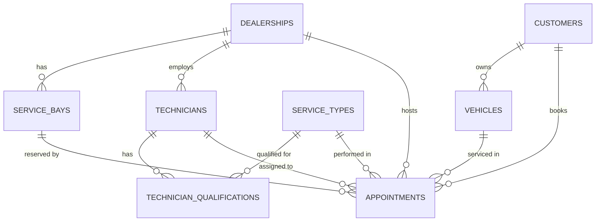

# Data dictionary

The PostgreSQL schema behind the domain. It is the target for the M1 Prisma schema and migration.
Terms follow the glossary in `requirements.md`. Rules (BR-x) refer to `requirements.md` › Business rules.

> The tables are a **storage shape**, not the domain model (see `architecture/domain.md` › Domain entity ≠ database table). For example, `start_at`/`end_at` become one `TimeSlot`, and `opens_at`/`closes_at`/`time_zone` become one `OpeningHours`.

## Conventions
- Tables `snake_case` plural; Prisma models `PascalCase` singular with `@@map` / `@map`.
- Primary keys: `id uuid`, generated by the application (domain creates ids), no DB default.
- Every table has `created_at timestamptz NOT NULL DEFAULT now()` and `updated_at timestamptz NOT NULL` (set by Prisma `@updatedAt`). Omitted from the tables below.
- All instants are `timestamptz` and stored in UTC. Local wall-clock values (opening hours) are `time` plus an IANA `time_zone`.
- Foreign keys are `ON DELETE RESTRICT` unless stated: reference data with appointments can't be deleted by accident.
- Invariants are enforced in the database **as well as** in the domain (defence in depth). The constraint names below are stable, so the infrastructure layer can map violations to domain errors.

## Entity relationships



| Module | Tables | Written by |
|---|---|---|
| `dealerships` | `dealerships`, `service_bays`, `technicians`, `service_types`, `technician_qualifications` | Seed only (read-only at runtime, A-2) |
| `customers` | `customers`, `vehicles` | Seed only (A-2) |
| `appointments` | `appointments` | The API (create, cancel) |

## Tables

### `dealerships`
| Column | Type | Null | Constraints / notes | Example |
|---|---|---|---|---|
| `id` | `uuid` | no | PK | `10000000-…-000000000001` |
| `name` | `text` | no | unique | `Keyloop Motors Bangkok` |
| `time_zone` | `text` | no | IANA zone name; validated by the app at seed time | `Asia/Bangkok` |
| `opens_at` | `time` | no | local wall-clock time | `08:00` |
| `closes_at` | `time` | no | `CHECK (closes_at > opens_at)` (no overnight opening, A-6) | `18:00` |

Domain: entity `Dealership` with value object `OpeningHours(opensAt, closesAt, timeZone)`.

### `service_bays`
| Column | Type | Null | Constraints / notes | Example |
|---|---|---|---|---|
| `id` | `uuid` | no | PK | `20000000-…-000000000101` |
| `dealership_id` | `uuid` | no | FK → `dealerships.id` | |
| `name` | `text` | no | `UNIQUE (dealership_id, name)` | `Bay 1` |

Extra: `UNIQUE (id, dealership_id)`, the target of the composite FK from `appointments` (see below). Index on `dealership_id`.

### `technicians`
| Column | Type | Null | Constraints / notes | Example |
|---|---|---|---|---|
| `id` | `uuid` | no | PK | `30000000-…-000000000104` |
| `dealership_id` | `uuid` | no | FK → `dealerships.id` | |
| `name` | `text` | no | | `Decha Phongsri` |

Extra: `UNIQUE (id, dealership_id)` for the composite FK. Index on `dealership_id`.

### `service_types`
| Column | Type | Null | Constraints / notes | Example |
|---|---|---|---|---|
| `id` | `uuid` | no | PK | `40000000-…-000000000007` |
| `code` | `text` | no | unique; `CHECK (code ~ '^[A-Z][A-Z0-9_]*$')` | `TRANSMISSION_REPAIR` |
| `name` | `text` | no | | `Transmission repair` |
| `duration_minutes` | `integer` | no | `CHECK (duration_minutes > 0 AND duration_minutes % 15 = 0)` (fits the 15-min grid, A-9) | `180` |

Global, not per dealership: whether a dealership "offers" a service follows from its technicians' qualifications (BR-6).

### `technician_qualifications`
| Column | Type | Null | Constraints / notes |
|---|---|---|---|
| `technician_id` | `uuid` | no | FK → `technicians.id` `ON DELETE CASCADE` |
| `service_type_id` | `uuid` | no | FK → `service_types.id` |

PK `(technician_id, service_type_id)`. Index on `service_type_id` (lookup: "who at this dealership can do X?"). No own `id`, `created_at` only.

### `customers`
| Column | Type | Null | Constraints / notes | Example |
|---|---|---|---|---|
| `id` | `uuid` | no | PK | `50000000-…-000000000001` |
| `first_name` | `text` | no | | `Somsak` |
| `last_name` | `text` | no | | `Jaidee` |
| `email` | `text` | no | unique index on `lower(email)` | `somsak.jaidee@example.com` |
| `phone` | `text` | yes | E.164-ish, not validated beyond length | `+66 81 000 0001` |

### `vehicles`
| Column | Type | Null | Constraints / notes | Example |
|---|---|---|---|---|
| `id` | `uuid` | no | PK | `60000000-…-000000000001` |
| `customer_id` | `uuid` | no | FK → `customers.id` (owner) | |
| `vin` | `char(17)` | no | unique; `CHECK (vin ~ '^[A-HJ-NPR-Z0-9]{17}$')` (no I, O, Q) | `MR053REE7K0123456` |
| `registration` | `text` | no | Thai/Vietnamese formats differ; not validated beyond non-empty | `1กข 2345`, `51K-123.45` |
| `make` | `text` | no | | `Toyota` |
| `model` | `text` | no | | `Corolla Altis` |
| `year` | `smallint` | no | `CHECK (year BETWEEN 1950 AND 2100)` | `2019` |

Extra: `UNIQUE (id, customer_id)` for the ownership FK. Index on `customer_id`.

### `appointments`
| Column | Type | Null | Constraints / notes |
|---|---|---|---|
| `id` | `uuid` | no | PK |
| `dealership_id` | `uuid` | no | FK → `dealerships.id` |
| `service_bay_id` | `uuid` | no | composite FK `(service_bay_id, dealership_id)` → `service_bays (id, dealership_id)`: bay belongs to the same dealership |
| `technician_id` | `uuid` | no | composite FK `(technician_id, dealership_id)` → `technicians (id, dealership_id)`: technician belongs to the same dealership |
| `service_type_id` | `uuid` | no | FK → `service_types.id`; plus composite FK `(technician_id, service_type_id)` → `technician_qualifications`: technician is qualified (BR-6/8) |
| `customer_id` | `uuid` | no | FK → `customers.id` |
| `vehicle_id` | `uuid` | no | composite FK `(vehicle_id, customer_id)` → `vehicles (id, customer_id)`: vehicle owned by customer (BR-5) |
| `start_at` | `timestamptz` | no | UTC |
| `end_at` | `timestamptz` | no | `CHECK (end_at > start_at)`; = start + duration (BR-1, set by the domain) |
| `status` | `appointment_status` | no | enum `CONFIRMED`, `CANCELLED`; default `CONFIRMED` |
| `cancelled_at` | `timestamptz` | yes | `CHECK ((status = 'CANCELLED') = (cancelled_at IS NOT NULL))` |

**No double-booking (BR-10)**, using exclusion constraints (needs the `btree_gist` extension):
```sql
CREATE EXTENSION IF NOT EXISTS btree_gist;

ALTER TABLE appointments
  ADD CONSTRAINT appointments_no_bay_overlap
  EXCLUDE USING gist (service_bay_id WITH =, tstzrange(start_at, end_at, '[)') WITH &&)
  WHERE (status = 'CONFIRMED');

ALTER TABLE appointments
  ADD CONSTRAINT appointments_no_technician_overlap
  EXCLUDE USING gist (technician_id WITH =, tstzrange(start_at, end_at, '[)') WITH &&)
  WHERE (status = 'CONFIRMED');
```
- `'[)'` = half-open interval, so back-to-back appointments are allowed (BR-2).
- `WHERE status = 'CONFIRMED'`: cancelled appointments don't block (BR-9).
- A violation raises SQLSTATE `23P01`; the Prisma adapter maps it to `AppointmentConflictError` (409 `APPOINTMENT_CONFLICT`) and the handler retries (see M2).
- The GiST indexes these constraints create also serve "is this bay/technician busy?" lookups.

**Indexes**
| Index | Serves |
|---|---|
| `(dealership_id, start_at) WHERE status = 'CONFIRMED'` | `findConfirmedOverlapping(dealershipId, slot)`, availability for a day (FR-7) |
| `(dealership_id, created_at DESC, id DESC)` | List by dealership, cursor pagination (FR-9) |
| `(customer_id, created_at DESC, id DESC)` | List by customer, cursor pagination (FR-9) |
| `(vehicle_id)`, `(service_type_id)` | FK lookups |

**Idempotency (FR-11, Could, M3):** if built, a separate table `idempotency_keys (key text PK, request_hash text, appointment_id uuid FK, created_at)` rather than columns on `appointments`.

## What the database guarantees vs the domain
| Rule | Domain | Database |
|---|---|---|
| BR-1 end = start + duration | ✔ computes it | `end_at > start_at` only |
| BR-2 half-open intervals | ✔ `TimeSlot.overlaps` | ✔ `tstzrange(…, '[)')` |
| BR-3 start in the future | ✔ | ✘ (depends on "now") |
| BR-4 within opening hours | ✔ `OpeningHours.contains` | ✘ (needs time zone logic) |
| BR-5 vehicle owned by customer | ✔ | ✔ composite FK |
| BR-6/8 technician qualified | ✔ allocator | ✔ composite FK to qualifications |
| Bay/technician at the same dealership | ✔ allocator | ✔ composite FKs |
| BR-7/8/10 no overlap | ✔ allocator (best effort) | ✔ **exclusion constraints (authoritative under concurrency)** |
| BR-9 cancelled don't block | ✔ | ✔ partial constraint |
| BR-12 only confirmed can be cancelled | ✔ | `status`/`cancelled_at` consistency check |

## Prisma notes
- Prisma can't express exclusion constraints, `tstzrange` or partial indexes: add them as raw SQL in the M1 migration and keep this file as the reference. Prisma's schema is therefore not the whole truth.
- Composite FKs: declare `@@unique([id, dealershipId])` on `ServiceBay`/`Technician` and `@@unique([id, customerId])` on `Vehicle`, then `@relation(fields: [serviceBayId, dealershipId], references: [id, dealershipId])` on `Appointment`.
- `time` columns: `@db.Time(0)`; enum: `enum AppointmentStatus { CONFIRMED CANCELLED }` mapped to `appointment_status`.
- `vin`: `@db.Char(17)`; `year`: `@db.SmallInt`.
